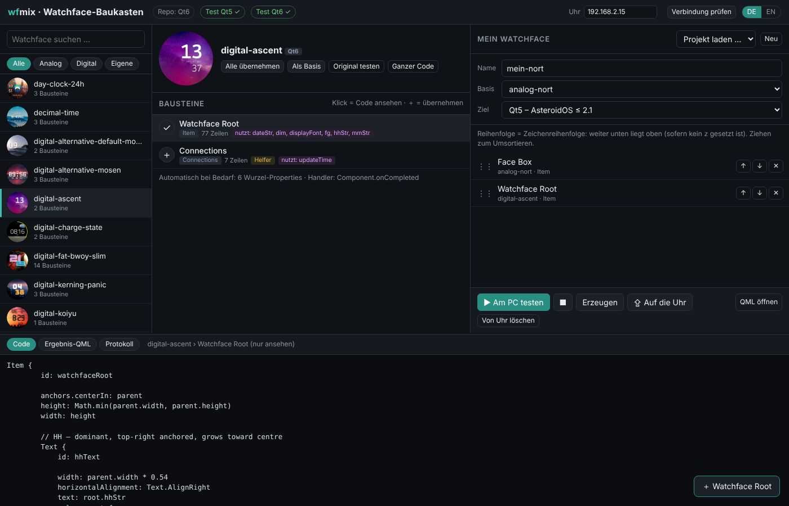

# wfmix – Watchface-Baukasten für AsteroidOS (Qt5 + Qt6)

🇬🇧 [English instructions: README.md](README.md)

Mit wfmix kombinierst du Bausteine (Zeiger, Ziffern, Ringe, Datum, Akku …) aus beliebigen
Watchfaces des Repos [AsteroidOS/unofficial-watchfaces](https://github.com/AsteroidOS/unofficial-watchfaces)
zu einem neuen Watchface. Du kannst Teile löschen, den Code einzelner Bausteine bearbeiten,
das Ergebnis am PC testen und per SSH auf die Uhr laden – alles über eine kleine Oberfläche im Browser.

- Funktioniert mit **beiden** Repo-Ständen: Qt5 (AsteroidOS ≤ 2.1, Commit `2c605dc`) und Qt6 (AsteroidOS ≥ 2.2, `master`)
- Erzeugt Watchfaces wahlweise für **Qt5 oder Qt6**, egal welcher Stand ausgecheckt ist – z.B. die neuesten Watchfaces auf einer Qt5-Uhr
- Oberfläche auf **Deutsch und Englisch** (Umschalter oben rechts)
- Nur Python-3-Standardbibliothek, keine Zusatzpakete



| Testfenster (Qt6-Watchface nach Qt5 umgewandelt) | Beispiel-Ergebnis |
|---|---|
|  |  |

## Welche Qt-Version hat meine Uhr?

| AsteroidOS | Qt | Ziel in wfmix |
|---|---|---|
| 1.x, 2.0, 2.1 | Qt 5.15 | **Qt5** |
| 2.2 und neuer | Qt 6 | **Qt6** |

Unsicher? In wfmix auf **Verbindung prüfen** klicken (oder `ssh root@192.168.2.15 "ls /usr/lib | grep -E 'libQt[56]Core'"`).
wfmix stellt das passende Ziel dann automatisch ein.

## Voraussetzungen

- Linux mit Python 3.8 oder neuer
- `git` und ein **Git-Klon** von unofficial-watchfaces (wird für den Test der jeweils anderen Qt-Version am PC gebraucht)
- Für den Test am PC (Ubuntu/Debian) – die Pakete für das Ziel bzw. die Ziele, die du nutzt:
  - Qt5:
    ```
    sudo apt install qmlscene qml-module-qtquick2 qml-module-qtquick-controls2 qml-module-qtquick-layouts qml-module-qtgraphicaleffects qml-module-qt-labs-settings qml-module-qtquick-dialogs qml-module-qtquick-shapes qml-module-qtquick-window2
    ```
  - Qt6:
    ```
    sudo apt install qml-qt6 qml6-module-qtquick qml6-module-qtquick-controls qml6-module-qtquick-layouts qml6-module-qt5compat-graphicaleffects qml6-module-qtquick-shapes qml6-module-qtquick-window qml6-module-qtcore qml6-module-qtquick-templates qml6-module-qtqml-workerscript qml6-module-qt-labs-settings qml6-module-qtquick-dialogs libqt6svg6 qt6-image-formats-plugins
    ```
- Zum Übertragen: eine AsteroidOS-Uhr im Developer-Mode (Einstellungen → USB), erreichbar mit `ssh root@192.168.2.15` ohne Passwortabfrage

Oben in wfmix siehst du, ob der Test mit Qt5 / Qt6 möglich ist (✓ / ✗).

## Installation

```
git clone https://github.com/AsteroidOS/unofficial-watchfaces
cd unofficial-watchfaces
git clone https://github.com/<dein-benutzername>/wfmix
python3 wfmix/wfmix.py
```

So bekommst du die neuesten Watchfaces (Qt6-Stand). Wer lieber den Qt5-Stand des Repos nutzt, führt vorher
im Ordner `unofficial-watchfaces` `git checkout 2c605dc` aus – wfmix funktioniert mit beiden.

wfmix muss im Ordner `unofficial-watchfaces` liegen (`unofficial-watchfaces/wfmix/wfmix.py`),
oder du gibst den Pfad mit `--repo /pfad/zu/unofficial-watchfaces` an.
Der Browser öffnet sich auf http://127.0.0.1:8777. Wenn du im Ordner `wfmix` stehst, startest du mit `python3 wfmix.py`.

## Bedienung

- **Links:** Watchface wählen (Suche, Filter Analog/Digital/Eigene)
- **Mitte:** die Bausteine dieses Watchfaces
  - Klick = Code ansehen, **＋** = übernehmen, **✓** = schon übernommen (erneuter Klick entfernt ihn)
  - „Alle übernehmen“ = ein Watchface komplett übernehmen, um danach Teile zu löschen
  - Markierungen: *braucht* = wird automatisch mitgenommen · *nutzt* = Wurzel-Properties, die automatisch mitkommen · *Helfer* = zeichnet nichts, steuert nur · *nur Qt5/Qt6* = Effekt, den es nur in einer Qt-Version gibt
- **Rechts:** dein Watchface
  - ✕ löscht, ↑ ↓ oder Ziehen sortiert um (weiter unten = liegt oben)
  - Klick auf einen Eintrag öffnet den Code zum Bearbeiten (Übernehmen oder Strg+S)
  - **Basis** liefert Wurzel-Einstellungen und das Vorschaubild
  - **Ziel** wählt Qt5 oder Qt6
- **▶ Am PC testen:** erzeugt das Watchface und öffnet das Testfenster (rund/eckig, Ambient-Modus, 12h, feste Uhrzeit …) mit der passenden Qt-Version. Erneut klicken = neu laden.
- **⇪ Auf die Uhr:** kopiert per `scp` nach `/usr/share/`, aktiviert das Watchface und startet die Oberfläche der Uhr neu
- **Protokoll:** zeigt, was automatisch ergänzt, umbenannt, umgewandelt oder entfernt wurde, und die QML-Meldungen des Tests

## Was automatisch passiert

- Bausteine, deren ids ein gewählter Baustein benutzt, werden mitgenommen.
- Helfer wie `Connections { target: wallClock … }`, die gewählte Zeiger bewegen, werden mitgenommen. Zeilen für nicht gewählte Teile werden dabei herausgefiltert, ebenso in `Component.onCompleted` und in Funktionen.
- Wurzel-Properties und Funktionen werden nur mitgenommen, wenn sie gebraucht werden.
- Bei Namenskonflikten zwischen verschiedenen Watchfaces werden ids und Properties umbenannt (z.B. `hourHand_Pulsedot`).
- Bilder, Schriften und JS-Dateien der Quellen werden mitkopiert. Die Lizenzköpfe aller Quellen bleiben erhalten.
- Das Projekt wird in `mixed/<name>/wfmix-projekt.json` gespeichert und ist über „Projekt laden“ wieder bearbeitbar.

### Umwandlung Qt5 ↔ Qt6

| | Ziel Qt5 | Ziel Qt6 |
|---|---|---|
| Importe | mit Version (`import QtQuick 2.15`) | ohne Version (`import QtQuick`) |
| Grafik-Effekte | `QtGraphicalEffects 1.15` | `Qt5Compat.GraphicalEffects` |
| Handler in `Connections` | unverändert | `onFoo: …` → `function onFoo() { … }` |
| `MultiEffect`-Schatten (nur Qt6) | wird zu `DropShadow` | unverändert |
| Andere `MultiEffect` / Qt6-Shader (`.qsb`) | entfernt (mit Hinweis im Protokoll) | unverändert |
| Qt5-Shader (GLSL im Code) | unverändert | entfernt (mit Hinweis im Protokoll) |
| `FontLoader { name: … }` | unverändert | Schriftname direkt eingesetzt (unter Qt6 nur lesbar) |

Für den Test der *anderen* Qt-Version am PC holt wfmix `loader.qml` und `fake-components` dieser Version
aus der Git-Historie deines Klons (`2c605dc` für Qt5, `master` für Qt6) – an deinem ausgecheckten Stand ändert sich nichts.

## Tipp: flüssiger Sekundenzeiger

Den Baustein mit dem Sekundenzeiger bearbeiten und in dessen Rotation ein `Behavior` einfügen:

```qml
transform: Rotation {
    id: secondRot
    origin.x: parent.width / 2
    origin.y: parent.height / 2

    Behavior on angle {
        enabled: !displayAmbient
        RotationAnimation {
            duration: 1000
            easing.type: Easing.Linear
            direction: RotationAnimation.Clockwise
        }
    }
}
```

Hinweis: Die durchgehende Animation braucht bei eingeschaltetem Display spürbar mehr Akku.

## Kommandozeile

```
python3 wfmix/wfmix.py list                     # alle Watchfaces
python3 wfmix/wfmix.py blocks analog-commander  # Bausteine eines Watchfaces
python3 wfmix/wfmix.py build mixed/NAME/wfmix-projekt.json [--target 5|6]
python3 wfmix/wfmix.py test NAME [--target 5|6]
python3 wfmix/wfmix.py deploy NAME --host 192.168.2.15
python3 wfmix/wfmix.py --lang de                # Sprache von Oberfläche und Meldungen (de/en)
python3 wfmix/wfmix.py --help                   # alle Optionen
```

## Hinweise

- Der Ordner `stubs/` enthält Platzhalter für `org.asteroid.controls`, `org.asteroid.utils` und `org.asteroid.sensorlogd`. Sie werden **nur am PC** benutzt, damit Watchfaces mit diesen Importen im Testfenster laufen. Auf die Uhr kommen sie nicht.
- Für den Test nutzt wfmix eine Kopie von `loader.qml` mit zusätzlichen Objekten, die der Launcher auf der Uhr bereitstellt (`compositor`, `desktop`, `localeManager`, `burnInProtectionManager`). Temporäre Dateien liegen unter `~/.cache/wfmix`.
- Qt 6.4 (Ubuntu 24.04) hat noch kein `QtQuick.Effects` (`MultiEffect`, ab Qt 6.5). Watchfaces damit (z.B. analog-nort) lassen sich auf so einem PC nicht mit Qt6 testen, auf der Uhr laufen sie. Mit Ziel Qt5 klappt der Test (der Schatten wird umgewandelt).
- Erzeugte Watchfaces enthalten Code und Dateien aus unofficial-watchfaces. Dafür gelten weiterhin deren Lizenzen (meist LGPL-2.1-or-later; Schriften laut README von unofficial-watchfaces).

## Übersetzungen

wfmix nutzt **GNU gettext**. Ausgangssprache ist Englisch, Übersetzungen sind normale `.po`-Dateien:

```
locale/wfmix.pot                    # Vorlage mit allen Texten (erzeugt)
locale/de/LC_MESSAGES/wfmix.po      # Deutsch
```

Derselbe Katalog gilt für Meldungen aus Python (`_("…")`) und für die Weboberfläche (`T("…")` und `data-t…`-Attribute, als JSON ausgeliefert).
Die `.po`-Dateien werden beim Start nach `~/.cache/wfmix/locale` übersetzt – `msgfmt` ist nicht nötig. Jede Sprache mit `.po`-Datei erscheint automatisch in der Sprachauswahl.

- **Sprache hinzufügen:** `python3 tools/update_po.py --init fr`, dann `locale/fr/LC_MESSAGES/wfmix.po` übersetzen (z.B. mit Poedit) und wfmix neu starten.
- **Nach Textänderungen im Code:** `python3 tools/update_po.py` aktualisiert die Vorlage und alle `.po`-Dateien (vorhandene Übersetzungen bleiben, neue Texte kommen dazu, ungenutzte fallen weg).
- **Vollständigkeit prüfen:** `python3 tools/update_po.py --check`

Geprüft: alle 162 Texte erscheinen auf Deutsch und Englisch genau wie vor der Umstellung (Python-Meldungen und die komplette Oberfläche mit der Vorversion verglichen); die von wfmix geschriebenen `.mo`-Dateien liefern dieselben Ergebnisse wie Dateien von `msgfmt`; `msgfmt -c` akzeptiert die `.po`-Dateien. Nicht geprüft: Sprachen mit Schreibrichtung von rechts nach links und Pluralformen (wfmix hat noch keine Texte mit Mehrzahl).

## Sicherheit

wfmix startet einen kleinen Webserver **nur auf deinem eigenen Rechner** (127.0.0.1) und ruft lokale Programme auf
(`ssh`, `scp`, `git`, `qmlscene`/`qml`, `xdg-open`). Damit andere Webseiten, die im Browser offen sind, das nicht ausnutzen können:

- Jedes Programm wird mit einer Argumentliste gestartet, nie über eine Shell.
- Die Adresse der Uhr muss eine gültige IP-Adresse oder ein Hostname sein; `--` beendet die Optionen von `ssh`/`scp`, die Adresse kann also nie als Option gelesen werden.
- Watchface-Namen dürfen nur `a-z`, `0-9` und `-` enthalten; alle Pfade werden geprüft, dass sie im Repo bzw. im Ordner `mixed/` bleiben. Vorhandene Watchfaces werden nur über ihre bekannte id angesprochen, nie über freie Pfade.
- Der Server nimmt nur Anfragen an `127.0.0.1`/`localhost` an (Schutz gegen DNS-Rebinding).
- Jede Aktion (POST) braucht ein Zufalls-Token, das bei jedem Start neu erzeugt wird und nur in der eigenen Seite von wfmix steht, dazu einen passenden `Origin` und `Content-Type: application/json`. Fremde Webseiten können das Token nicht lesen.
- Archive aus der Git-Historie werden nur als normale Dateien innerhalb des Cache-Ordners entpackt.

Geprüft: automatische Tests für alle Punkte oben (fremder `Host`/`Origin`, fehlendes/falsches Token, Anfragen fremder Seiten aus einem echten Browser, Einschleusen von ssh-Optionen, Path Traversal) sowie die genauen `ssh`-/`scp`-Befehlszeilen. Nicht geprüft: eine Sicherheitsprüfung durch Dritte.

## Lizenz

wfmix selbst steht unter der [MIT-Lizenz](LICENSE).
