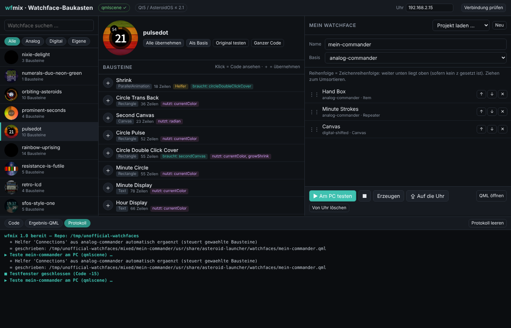
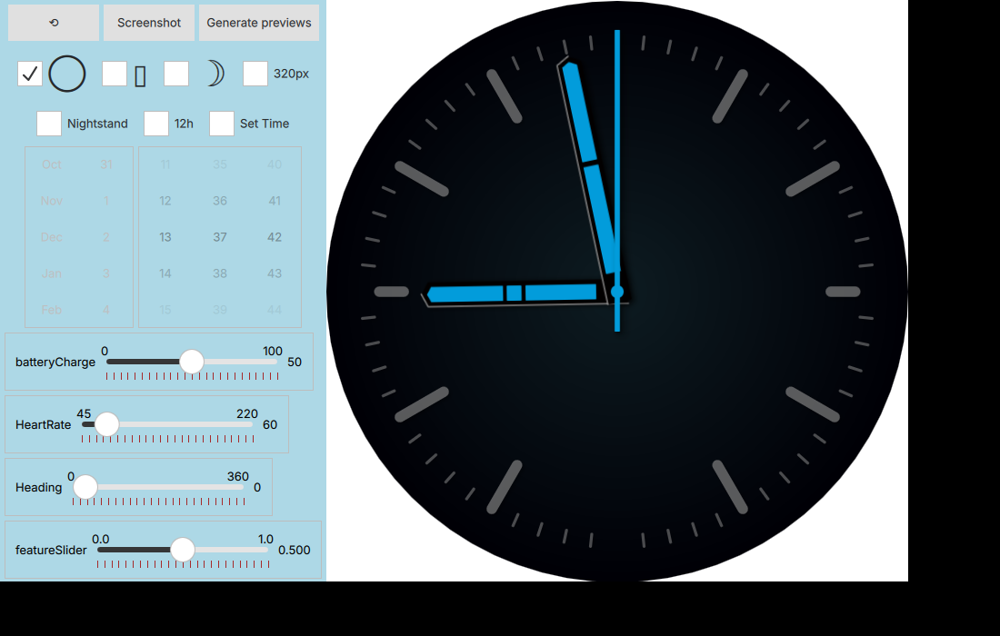
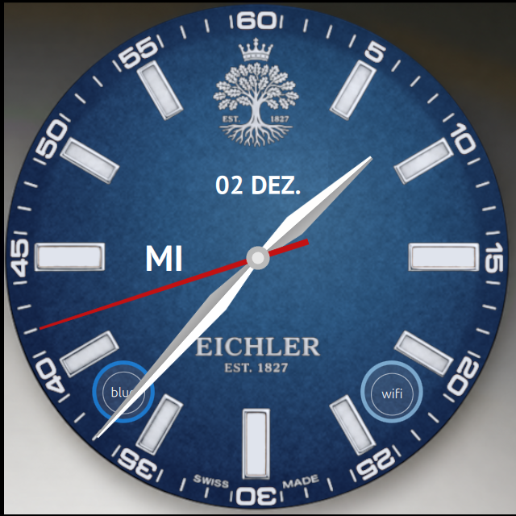

# wfmix – Watchface Construction Kit for AsteroidOS (Qt5 + Qt6)

🇩🇪 [Deutsche Anleitung: LIESMICH.md](LIESMICH.md)

wfmix lets you combine building blocks (hands, numerals, rings, date, battery …) from any
watchface in [AsteroidOS/unofficial-watchfaces](https://github.com/AsteroidOS/unofficial-watchfaces)
into a new watchface. You can delete parts, edit the code of individual blocks, test the result
on your PC and deploy it to the watch via SSH – all from a small web UI in your browser.

- Works with **both** repository states: Qt5 (AsteroidOS ≤ 2.1, commit `2c605dc`) and Qt6 (AsteroidOS ≥ 2.2, `master`)
- Generates watchfaces for **Qt5 or Qt6**, whichever state is checked out – e.g. use the newest watchfaces on a Qt5 watch
- User interface in **German and English** (switch at the top right)
- Only Python 3 standard library, no extra packages



| Test window (Qt6 watchface converted to Qt5) | Example result |
|---|---|
|  |  |

## Which Qt version does my watch use?

| AsteroidOS | Qt | Target in wfmix |
|---|---|---|
| 1.x, 2.0, 2.1 | Qt 5.15 | **Qt5** |
| 2.2 and newer | Qt 6 | **Qt6** |

Not sure? Click **Check connection** in wfmix (or run `ssh root@192.168.2.15 "ls /usr/lib | grep -E 'libQt[56]Core'"`).
wfmix then selects the matching target automatically.

## Requirements

- Linux with Python 3.8 or newer
- `git` and a **git clone** of unofficial-watchfaces (needed to test the other Qt version on the PC)
- For testing on the PC (Ubuntu/Debian) – install the packages for the target(s) you use:
  - Qt5:
    ```
    sudo apt install qmlscene qml-module-qtquick2 qml-module-qtquick-controls2 qml-module-qtquick-layouts qml-module-qtgraphicaleffects qml-module-qt-labs-settings qml-module-qtquick-dialogs qml-module-qtquick-shapes qml-module-qtquick-window2
    ```
  - Qt6:
    ```
    sudo apt install qml-qt6 qml6-module-qtquick qml6-module-qtquick-controls qml6-module-qtquick-layouts qml6-module-qt5compat-graphicaleffects qml6-module-qtquick-shapes qml6-module-qtquick-window qml6-module-qtcore qml6-module-qtquick-templates qml6-module-qtqml-workerscript qml6-module-qt-labs-settings qml6-module-qtquick-dialogs libqt6svg6 qt6-image-formats-plugins
    ```
- For deploying: an AsteroidOS watch in Developer mode (Settings → USB), reachable via `ssh root@192.168.2.15` without password prompt

The header of wfmix shows whether testing with Qt5 / Qt6 is available (✓ / ✗).

## Installation

```
git clone https://github.com/AsteroidOS/unofficial-watchfaces
cd unofficial-watchfaces
git clone https://github.com/<your-username>/wfmix
python3 wfmix/wfmix.py
```

This uses the newest watchfaces (Qt6 state). If you prefer the Qt5 state of the repository, run
`git checkout 2c605dc` inside `unofficial-watchfaces` first – wfmix works with both.

wfmix must live inside the `unofficial-watchfaces` folder (`unofficial-watchfaces/wfmix/wfmix.py`),
or point it to the repo with `--repo /path/to/unofficial-watchfaces`.
Your browser opens http://127.0.0.1:8777. When starting from inside the `wfmix` folder, use `python3 wfmix.py`.

## Usage

- **Left:** pick a watchface (search, filter *Analog* / *Digital* / *Own*)
- **Middle:** the building blocks of that watchface
  - Click = view code, **＋** = add to your watchface, **✓** = already added (click again to remove)
  - *Add all* = take over a complete watchface so you can delete parts afterwards
  - Tags: *needs* = added automatically · *uses* = root properties that come along automatically · *Helper* = draws nothing, only controls other blocks · *Qt5/Qt6 only* = effect that only exists in one Qt version
- **Right:** your watchface
  - ✕ deletes, ↑ ↓ or drag & drop reorders (further down = drawn on top)
  - Click an entry to edit its code (*Apply* or Ctrl+S)
  - *Base* provides the root settings and the preview image
  - *Target* selects Qt5 or Qt6
- **▶ Test on PC:** generates the watchface and opens the test window (round/square, ambient mode, 12h, fixed time …) with the matching Qt version. Click again = reload.
- **⇪ To the watch:** copies to `/usr/share/` via `scp`, activates the watchface and restarts the watch UI
- **Log:** shows what was added, renamed, converted or removed automatically, plus the QML messages from the test

## What happens automatically

- Blocks whose ids are used by a selected block are added.
- Helpers such as `Connections { target: wallClock … }` that move selected hands are added. Lines for parts that were not selected are filtered out, as are the matching lines in `Component.onCompleted` and in functions.
- Root properties and functions are only included when they are needed.
- On name conflicts between different watchfaces, ids and properties are renamed (e.g. `hourHand_Pulsedot`).
- Images, fonts and JS files from the source watchfaces are copied along. License headers of all sources are kept.
- The project is saved to `mixed/<name>/wfmix-projekt.json` and can be edited again via *Load project*.

### Qt5 ↔ Qt6 conversion

| | Qt5 target | Qt6 target |
|---|---|---|
| Imports | with versions (`import QtQuick 2.15`) | without versions (`import QtQuick`) |
| Graphical effects | `QtGraphicalEffects 1.15` | `Qt5Compat.GraphicalEffects` |
| `Connections` handlers | unchanged | `onFoo: …` → `function onFoo() { … }` |
| `MultiEffect` shadow (Qt6 only) | converted to `DropShadow` | unchanged |
| Other `MultiEffect` / Qt6 shaders (`.qsb`) | removed (with note in the log) | unchanged |
| Qt5 shaders (GLSL in the code) | unchanged | removed (with note in the log) |
| `FontLoader { name: … }` | unchanged | font name inserted directly (read-only on Qt6) |

To test the *other* Qt version on the PC, wfmix takes `loader.qml` and `fake-components` of that version
from the git history of your clone (`2c605dc` for Qt5, `master` for Qt6) – nothing changes in your checkout.

## Tip: smooth second hand

Edit the block containing the second hand and add a `Behavior` to its rotation:

```qml
transform: Rotation {
    id: secondRot
    origin.x: parent.width / 2
    origin.y: parent.height / 2

    Behavior on angle {
        enabled: !displayAmbient
        RotationAnimation {
            duration: 1000
            easing.type: Easing.Linear
            direction: RotationAnimation.Clockwise
        }
    }
}
```

Note: the continuous animation uses noticeably more battery while the display is on.

## Command line

```
python3 wfmix/wfmix.py list                     # all watchfaces
python3 wfmix/wfmix.py blocks analog-commander  # building blocks of a watchface
python3 wfmix/wfmix.py build mixed/NAME/wfmix-projekt.json [--target 5|6]
python3 wfmix/wfmix.py test NAME [--target 5|6]
python3 wfmix/wfmix.py deploy NAME --host 192.168.2.15
python3 wfmix/wfmix.py --lang en                # language of UI and messages (de/en)
python3 wfmix/wfmix.py --help                   # all options
```

## Notes

- The `stubs/` folder contains placeholders for `org.asteroid.controls`, `org.asteroid.utils` and `org.asteroid.sensorlogd`. They are used **on the PC only**, so watchfaces with these imports run in the test window. They are never copied to the watch.
- For testing, wfmix uses a copy of `loader.qml` with additional objects the watch launcher provides (`compositor`, `desktop`, `localeManager`, `burnInProtectionManager`). Temporary files are kept in `~/.cache/wfmix`.
- Qt 6.4 (Ubuntu 24.04) has no `QtQuick.Effects` (`MultiEffect`, Qt ≥ 6.5). Watchfaces using it (e.g. analog-nort) cannot be tested with Qt6 on such a PC; on the watch they work. Testing them with target Qt5 works (shadow is converted).
- Generated watchfaces contain code and assets from unofficial-watchfaces. Those keep their original licenses (mostly LGPL-2.1-or-later; fonts as listed in the unofficial-watchfaces README).

## Translations

wfmix uses **GNU gettext**. The source language is English; translations are normal `.po` files:

```
locale/wfmix.pot                    # template with all texts (generated)
locale/de/LC_MESSAGES/wfmix.po      # German
```

The same catalog is used for messages from Python (`_("…")`) and for the web UI (`T("…")` and `data-t…` attributes, served as JSON).
`.po` files are compiled at start into `~/.cache/wfmix/locale` – no `msgfmt` needed. Every language with a `.po` file automatically appears in the language selector.

- **Add a language:** `python3 tools/update_po.py --init fr`, then translate `locale/fr/LC_MESSAGES/wfmix.po` (e.g. with Poedit) and restart wfmix.
- **After changing texts in the code:** `python3 tools/update_po.py` updates the template and all `.po` files (keeps existing translations, adds new texts, removes unused ones).
- **Check completeness:** `python3 tools/update_po.py --check`

What was checked: all 162 texts show the same German and English wording as before the switch (Python messages and the complete UI compared with the previous version); the `.mo` files written by wfmix give the same results as files from `msgfmt`; `msgfmt -c` accepts the `.po` files. Not checked: right-to-left languages and plural forms (wfmix has no plural texts yet).

## Security

wfmix runs a small web server **on your own computer only** (127.0.0.1) and starts local programs
(`ssh`, `scp`, `git`, `qmlscene`/`qml`, `xdg-open`). To keep other websites open in your browser from misusing it:

- Every program is started with an argument list, never through a shell.
- The watch address must be a valid IP address or hostname; `--` ends the options of `ssh`/`scp`, so the address can never be read as an option.
- Watchface names are limited to `a-z`, `0-9` and `-`; all paths are checked to stay inside the repo or the `mixed/` folder. Existing watchfaces are only addressed by their known id, never by a free path.
- The server only accepts requests addressed to `127.0.0.1`/`localhost` (protects against DNS rebinding).
- Every action (POST) needs a random token created at each start, which is only contained in wfmix's own page, plus a matching `Origin` and `Content-Type: application/json`. Other websites cannot read the token.
- Archives from the git history are only unpacked as regular files inside the cache folder.

What was checked: automated tests for all points above (foreign `Host`/`Origin`, missing/wrong token, cross-site requests from a real browser, ssh option injection, path traversal) and the exact `ssh`/`scp` command lines. Not checked: an external security review.

## License

wfmix itself is released under the [MIT License](LICENSE).
